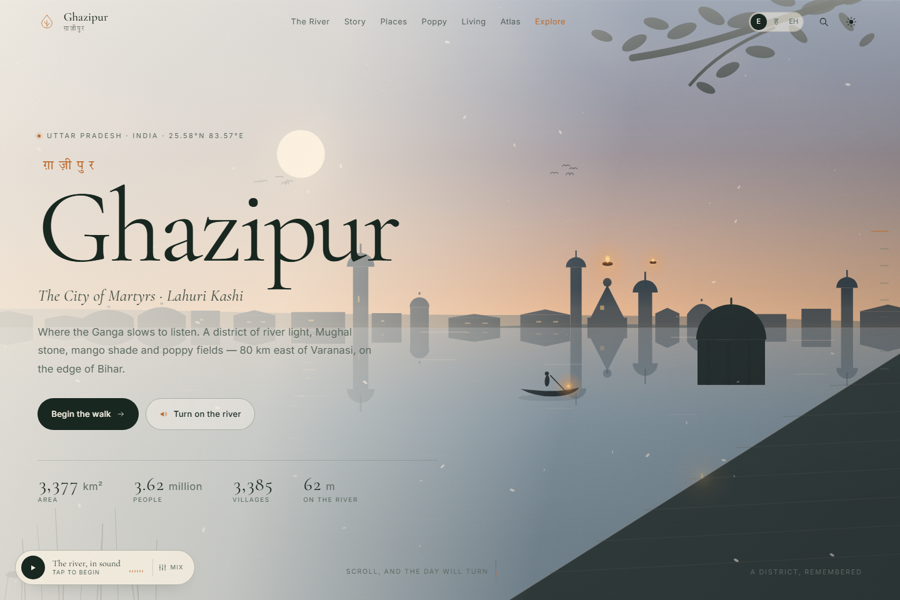
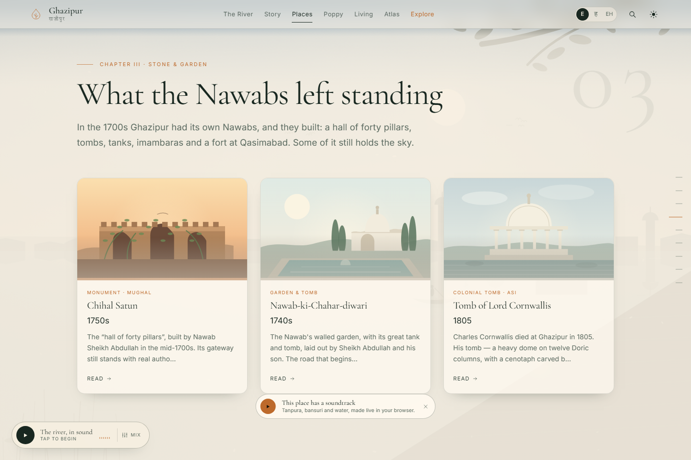
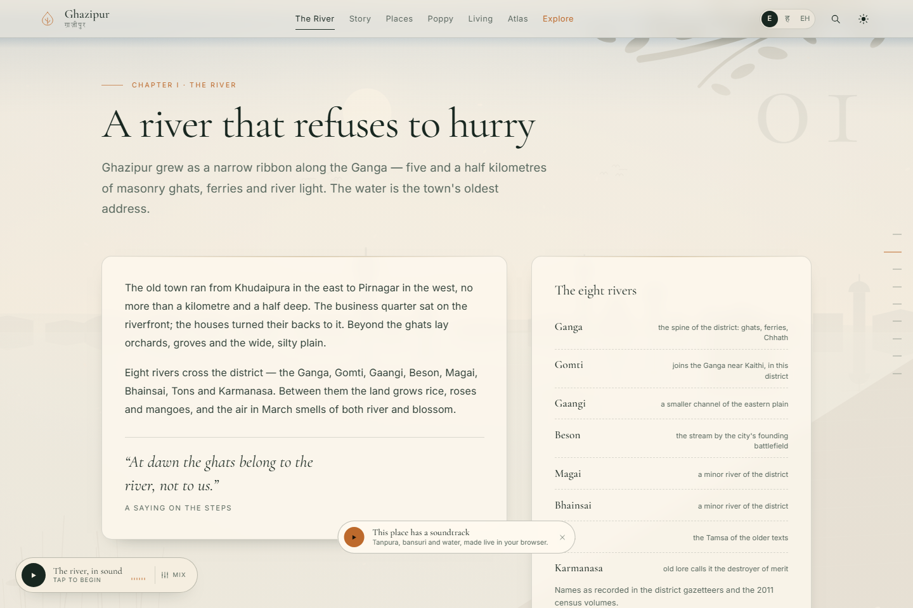

# Ghazipur — a living portrait

A dynamic, bilingual (English / हिन्दी / Hinglish) website about Ghazipur on the Ganga.
Light and dark modes, mobile friendly, with background music, ambient animation and sound effects.



## Highlights

- **Day and night, blended smoothly.** By day, kids play on the ghat and a fisherman casts his net. At night, the Ganga Aarti begins, diyas are lit along the steps, and people sit and watch.
- **Naav** — a small-boat game. Row, steer, collect floating diyas, with water and oar sound effects.
- **The Opium Factory yard** — brick works, watchtower, barbed wire, an operable narrow-gauge trolley, and an industrial siren you can sound.
- **Explore** section listing every creative piece on the site.
- Audio controller, language switch, theme switch, search, and a custom favicon.

| Night | The yard | Places |
|---|---|---|
|  |  |  |

| River | Explore | Mobile |
|---|---|---|
|  |  |  |

## Run locally

No build step. Open `index.html`, or serve the folder:

```
python -m http.server 8000
```

## Structure

- `index.html` — page
- `assets/css/style.css` — styles
- `assets/js/scene.js` — canvas scene (day/night, ghat life)
- `assets/js/naav.js` — boat game
- `assets/js/audio.js` — music and sound effects (Web Audio)
- `assets/js/i18n.js`, `assets/js/app.js` — languages and interactions
